# CRUD Operations on Items Using HTML, CSS, Express.js and REST API

> **College Assignment** – Third-Year Engineering | Web Technologies Practical

---

## Project Description

This project demonstrates **CRUD (Create, Read, Update, Delete)** operations on an array of items using a Node.js + Express.js backend, a vanilla HTML/CSS/JavaScript frontend, and a REST API for client–server communication.

Data is stored in an **in-memory JavaScript array** on the server (no database required), making the project self-contained and easy to run without any additional infrastructure.

---

## Aim of the Assignment

To understand and implement CRUD operations using a RESTful API architecture with an Express.js backend and a plain HTML/CSS/JavaScript frontend, demonstrating how modern web applications create, read, update, and delete data through HTTP methods.

---

## Objectives

- Implement a REST API using Express.js with proper HTTP methods and status codes.
- Perform CRUD operations on an in-memory JavaScript array.
- Build a responsive frontend that communicates with the API using the `fetch()` function.
- Validate input on both the frontend and the backend.
- Write automated API tests using Node.js built-in test runner.
- Document the project with a professional README including real application screenshots.

---

## Technologies Used

| Category   | Technology                        |
|------------|-----------------------------------|
| Runtime    | Node.js (v18+)                    |
| Backend    | Express.js 4.x                    |
| Frontend   | HTML5, CSS3, Vanilla JavaScript   |
| API Style  | REST (JSON over HTTP)             |
| HTTP Client| Browser `fetch()` API             |
| Data Store | In-memory JavaScript array        |
| Testing    | Node.js `node:test` + `node:assert` |
| Dev Tool   | nodemon (auto-restart)            |

---

## Features

- **Create** – Add a new item with a name and price using a form.
- **Read** – Items are loaded automatically from the server when the page opens.
- **Update** – Click Edit on any row to pre-fill the form, then submit the update.
- **Delete** – Click Delete on any row; a confirmation dialog prevents accidental deletion.
- **Input Validation** – Both frontend and backend reject empty names, negative prices, and non-numeric values.
- **Status Messages** – Clear success and error banners appear after every operation.
- **Responsive Layout** – Works correctly on desktops, tablets, and mobile devices.
- **Safe DOM Manipulation** – User data is always set via `textContent`, never via `innerHTML`.
- **Automated Tests** – 15 backend API tests covering all CRUD operations and edge cases.

---

## CRUD Operations Explained

| Operation | HTTP Method | Endpoint          | Description                    |
|-----------|-------------|-------------------|--------------------------------|
| Create    | `POST`      | `/api/items`      | Add a new item to the list     |
| Read All  | `GET`       | `/api/items`      | Retrieve all items             |
| Read One  | `GET`       | `/api/items/:id`  | Retrieve a single item by ID   |
| Update    | `PUT`       | `/api/items/:id`  | Update an existing item        |
| Delete    | `DELETE`    | `/api/items/:id`  | Remove an item from the list   |

---

## Project Folder Structure

```
MERTN task/
├── public/
│   ├── index.html          ← Frontend HTML page
│   ├── styles.css          ← CSS styles
│   └── app.js              ← Frontend CRUD logic (fetch API)
├── screenshots/
│   ├── initial-output.png
│   ├── add-item.png
│   ├── edit-item.png
│   ├── update-item.png
│   ├── delete-confirmation.png
│   └── final-output.png
├── server.js               ← Express server + REST API
├── package.json
├── package-lock.json
├── .gitignore
└── README.md
```

---

## REST API Endpoints

| Method   | Endpoint         | Description              | Success Code | Error Codes      |
|----------|------------------|--------------------------|:------------:|:----------------:|
| `GET`    | `/api/items`     | Return all items         | `200 OK`     | `500`            |
| `GET`    | `/api/items/:id` | Return one item          | `200 OK`     | `404`            |
| `POST`   | `/api/items`     | Create a new item        | `201 Created`| `400`            |
| `PUT`    | `/api/items/:id` | Update an existing item  | `200 OK`     | `400`, `404`     |
| `DELETE` | `/api/items/:id` | Delete an item           | `200 OK`     | `404`            |

---

## Prerequisites

- [Node.js](https://nodejs.org/) **v18.0.0 or higher** (required for the built-in `fetch` API and `node:test` runner)
- npm (included with Node.js)
- A modern web browser (Chrome, Firefox, Edge, Safari)

To check your Node.js version:
```bash
node --version
```

---

## Installation

1. **Clone or download** the project folder.

2. **Navigate** into the project directory:
   ```bash
   cd "MERTN task"
   ```

3. **Install dependencies**:
   ```bash
   npm install
   ```

---

## Running the Server

### Production mode
```bash
npm start
```

### Development mode (auto-restart on file changes)
```bash
npm run dev
```

Open your browser and visit: **[http://localhost:3000](http://localhost:3000)**

The server will print:
```
Server running on http://localhost:3000
```

To stop the server, press **Ctrl + C** in the terminal.

---

## Running Automated Tests

```bash
npm test
```

The test suite starts a temporary server on a random free port, runs all 15 tests, and shuts down cleanly.

### Expected output
```
TAP version 13
ok 1 - GET /api/items
ok 2 - GET /api/items/:id
ok 3 - POST /api/items
ok 4 - PUT /api/items/:id
ok 5 - DELETE /api/items/:id
ok 6 - Unknown API routes
ok 7 - Malformed JSON handling
1..7
# tests 15
# pass  15
# fail  0
```

---

## Application Screenshots

### Initial Output
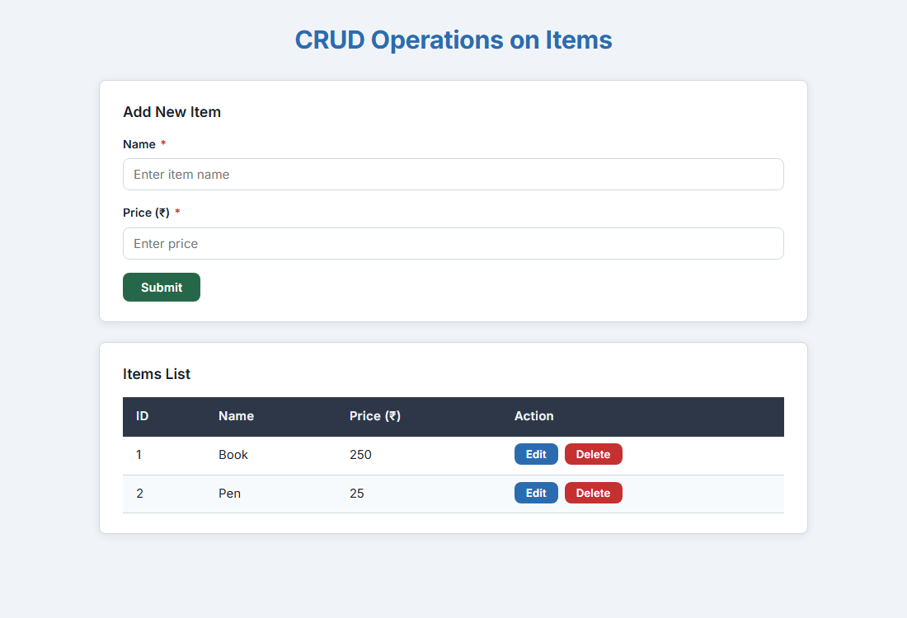

*The application loads with two pre-seeded items: Book (₹250) and Pen (₹25). The form is ready to accept new entries.*

---

### Adding a New Item


*After submitting the form with Name = "Notebook" and Price = 50, a success message appears and the table refreshes to show all three items.*

---

### Editing an Item
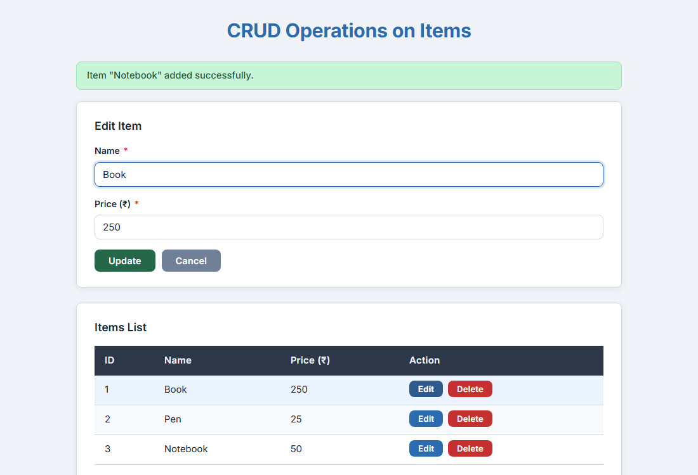

*Clicking the Edit button on the Book row fills the form with "Book" and "250". The Submit button changes to "Update" and a Cancel button appears.*

---

### Updating an Item
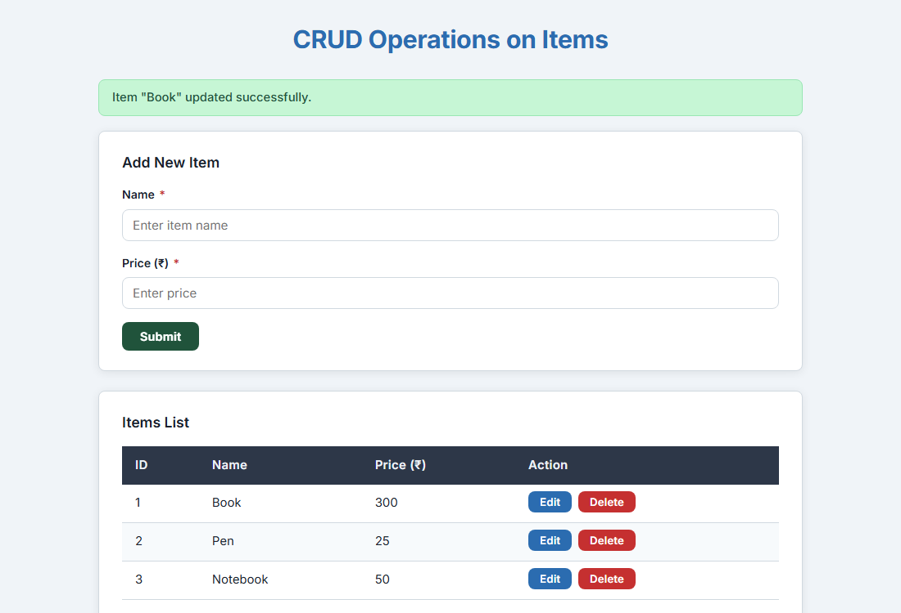

*After changing the price to 300 and clicking Update, the success message confirms the change. The table shows Book at ₹300, Pen at ₹25, and Notebook at ₹50.*

---

### Delete Confirmation
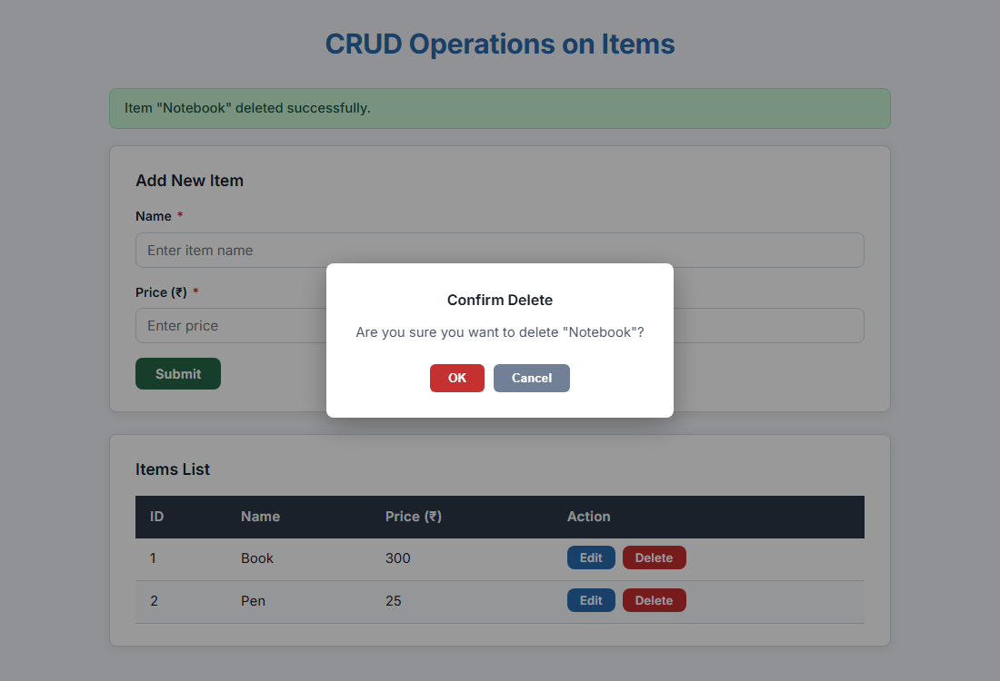

*Clicking Delete on the Notebook row triggers a browser confirmation dialog. The item is only removed if the user confirms.*

---

### Final Output
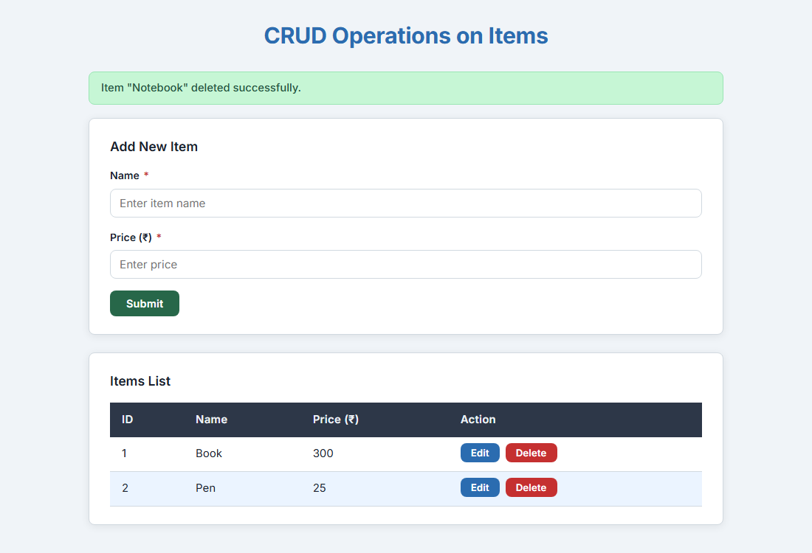

*After confirming the deletion of Notebook, the table returns to two items: Book (₹300) and Pen (₹25).*

---

## Expected Initial Data

When the server starts, it initialises the in-memory array with two sample records:

```json
[
  { "id": 1, "name": "Book",  "price": 250 },
  { "id": 2, "name": "Pen",   "price": 25  }
]
```

This data is reset every time the server restarts.

---

## Example API Requests and Responses

### GET /api/items
```bash
curl http://localhost:3000/api/items
```
```json
[
  { "id": 1, "name": "Book", "price": 250 },
  { "id": 2, "name": "Pen",  "price": 25  }
]
```

---

### GET /api/items/:id
```bash
curl http://localhost:3000/api/items/1
```
```json
{ "id": 1, "name": "Book", "price": 250 }
```

**404 response (item not found):**
```json
{ "error": "Item with id 99 not found." }
```

---

### POST /api/items
```bash
curl -X POST http://localhost:3000/api/items \
  -H "Content-Type: application/json" \
  -d '{"name": "Notebook", "price": 50}'
```
```json
{ "id": 3, "name": "Notebook", "price": 50 }
```

**400 response (validation error):**
```json
{ "error": "Field \"name\" must be a non-empty string." }
```

---

### PUT /api/items/:id
```bash
curl -X PUT http://localhost:3000/api/items/1 \
  -H "Content-Type: application/json" \
  -d '{"name": "Book", "price": 300}'
```
```json
{ "id": 1, "name": "Book", "price": 300 }
```

---

### DELETE /api/items/:id
```bash
curl -X DELETE http://localhost:3000/api/items/1
```
```json
{ "message": "Item \"Book\" deleted successfully.", "item": { "id": 1, "name": "Book", "price": 300 } }
```

---

## Limitations of In-Memory Storage

| Limitation | Explanation |
|------------|-------------|
| **Data is not persistent** | All items are lost when the server restarts. |
| **No concurrency safety** | Simultaneous requests from multiple users can cause race conditions. |
| **No authentication** | Any user can create, update, or delete any item. |
| **Single instance only** | Cannot be scaled across multiple server processes sharing state. |
| **No search or filtering** | The API returns all items; there is no built-in query support. |

---

## Future Enhancements

- **Database integration** – Replace the in-memory array with MongoDB, PostgreSQL, or SQLite for persistent storage.
- **User authentication** – Add JWT-based login so only authorised users can modify items.
- **Pagination and search** – Support query parameters like `?page=1&limit=10&search=book`.
- **Input sanitisation** – Add a library such as `express-validator` for more robust server-side validation.
- **HTTPS support** – Serve the application over TLS in production.
- **Frontend framework** – Migrate the UI to React or Vue for a more maintainable component structure.
- **Docker containerisation** – Package the application into a Docker image for easy deployment.

---

## Conclusion

This project demonstrates a complete CRUD web application built with Node.js, Express.js, and plain HTML/CSS/JavaScript — without any databases or frontend frameworks. It covers the full request–response cycle from the browser form to the REST API and back, with proper HTTP status codes, input validation on both ends, automated backend testing, and a clean, responsive user interface. The implementation follows practical software engineering principles: separation of concerns, safe DOM manipulation, graceful error handling, and test isolation — making it a solid foundation for more advanced web development work.

---

*Submitted as part of the Web Technologies practical assignment.*

---
---

# Task 2 — Sign Up and User CRUD Operations

> **College Lab Assignment – Task 2** | User Management & Authentication Interface

---

## Assignment Aim

To design and implement a clean, responsive frontend and RESTful Express.js backend for managing user accounts stored in an in-memory JavaScript array. The interface is inspired by a minimalist Sign Up design featuring a white background, underline input fields, and bold red action accents.

---

## Objectives

- Build a clean Sign Up and Log In interface adhering to the specified visual style (white background, red buttons and links, underline input fields).
- Implement full CRUD (Create, Read, Update, Delete) functionality for user accounts via REST API.
- Maintain separate, isolated endpoints and in-memory data storage for Task 2 under `/api/task2/users`.
- Ensure robust validation on both frontend and backend (valid email format, minimum 6-character passwords, duplicate email prevention).
- Display a masked password representation (`••••••••`) in the management table and never expose actual passwords in API responses.
- Implement an accessible deletion confirmation dialog with red action and neutral cancel buttons.
- Write automated unit and integration tests using Node.js built-in `node:test` runner.
- Capture real browser screenshots of the running application using Playwright.

---

## Technologies Used

| Category | Technology |
|---|---|
| **Runtime** | Node.js (v18+) |
| **Backend Framework** | Express.js 4.x |
| **Frontend** | Vanilla HTML5, CSS3, JavaScript (ES6+) |
| **Architecture** | REST API (JSON over HTTP) |
| **HTTP Client** | Browser `fetch()` API |
| **Data Store** | In-memory JavaScript array (`users`) |
| **Testing** | Node.js `node:test` and `node:assert` |
| **Automation** | Playwright (browser screenshots) |

---

## Project Structure

```
MERTN task/
├── public/
│   ├── index.html              ← Task 1 frontend (Items CRUD)
│   ├── styles.css              ← Task 1 styles
│   ├── app.js                  ← Task 1 client logic
│   └── task2/
│       ├── index.html          ← Task 2 frontend (Sign Up, Log In, Dashboard)
│       ├── styles.css          ← Task 2 styles (red theme, underline inputs)
│       └── app.js              ← Task 2 client logic (Users CRUD & modal)
├── screenshots/
│   ├── initial-output.png      ← Task 1 screenshot
│   ├── add-item.png            ← Task 1 screenshot
│   ├── edit-item.png           ← Task 1 screenshot
│   ├── update-item.png         ← Task 1 screenshot
│   ├── delete-confirmation.png ← Task 1 screenshot
│   ├── final-output.png        ← Task 1 screenshot
│   └── task2/
│       ├── signup-page.png         ← Initial Sign Up screen
│       ├── login-page.png          ← Log In screen
│       ├── signup-success.png      ← Registration success notification
│       ├── users-list.png          ← User management table with dummy users
│       ├── edit-user.png           ← Pre-populated user edit panel
│       ├── delete-confirmation.png ← Delete confirmation modal
│       └── after-delete.png        ← Table after user deletion
├── tests/
│   └── api.test.js             ← Automated test suite for Task 1 and Task 2
├── server.js                   ← Express server handling Task 1 and Task 2 APIs
├── take-screenshots.js         ← Automated Playwright screenshot script
├── package.json
└── README.md
```

---

## How the Application Works

1. **Initial Load**:
   - Navigating to `http://localhost:3000/task2` opens the Sign Up form.
   - The user can switch between the **Sign Up** and **Log In** forms via the header links.
2. **Registration (Create)**:
   - Entering an email and a password (min 6 characters) and submitting sends a `POST` request to `/api/task2/users`.
   - On success, a confirmation message appears and the user transitions into the User Management Dashboard.
3. **Log In**:
   - Submitting existing credentials sends a `POST` request to `/api/task2/users/login`.
   - On verification, the user enters the User Management Dashboard.
4. **User Management Dashboard (Read)**:
   - A `GET` request retrieves all registered users from `/api/task2/users`.
   - The table displays the user ID, email address, masked password indicator (`••••••••`), and Edit / Delete action buttons.
5. **Editing Users (Update)**:
   - Clicking **Edit** opens the edit panel with the selected user's email pre-filled.
   - The user can update the email and optionally enter a new password.
   - Submitting triggers a `PUT` request to `/api/task2/users/:id`, refreshing the table.
   - A neutral **Cancel** button dismisses the edit panel without changes.
6. **Deleting Users (Delete)**:
   - Clicking **Delete** opens a custom confirmation modal asking for confirmation.
   - Clicking **Delete** inside the modal issues a `DELETE` request to `/api/task2/users/:id`.
   - The user is removed from the array and the table refreshes immediately.

---

## CRUD Operations Explanation

| Operation | HTTP Method | Endpoint | Description |
|---|---|---|---|
| **Create** | `POST` | `/api/task2/users` | Register a new user with email and password |
| **Authenticate** | `POST` | `/api/task2/users/login` | Verify credentials for account login |
| **Read All** | `GET` | `/api/task2/users` | Fetch all users (passwords excluded) |
| **Read One** | `GET` | `/api/task2/users/:id` | Fetch a single user by numeric ID |
| **Update** | `PUT` | `/api/task2/users/:id` | Update email and/or password of a user |
| **Delete** | `DELETE` | `/api/task2/users/:id` | Remove a user record from the array |

---

## REST API Endpoints

| Method | Endpoint | Request Body | Success Code | Error Codes | Description |
|---|---|---|:---:|:---:|---|
| `GET` | `/api/task2/users` | None | `200 OK` | `500` | Returns array of safe user objects (`id`, `email`) |
| `GET` | `/api/task2/users/:id` | None | `200 OK` | `404` | Returns single user object (`id`, `email`) |
| `POST` | `/api/task2/users` | `{ "email": "...", "password": "..." }` | `201 Created` | `400`, `409` | Creates new user; rejects invalid fields or duplicates |
| `POST` | `/api/task2/users/login` | `{ "email": "...", "password": "..." }` | `200 OK` | `400`, `401` | Authenticates user; returns status message and email |
| `PUT` | `/api/task2/users/:id` | `{ "email": "...", "password": "..." }` | `200 OK` | `400`, `404`, `409` | Updates email and optional password; rejects conflicts |
| `DELETE` | `/api/task2/users/:id` | None | `200 OK` | `404` | Deletes user from the store |

---

## Installation and Run Instructions

### 1. Install Dependencies
```bash
npm install
```

### 2. Start the Server
```bash
npm start
```
The server will start on port 3000:
- **Task 1 (Items CRUD)**: [http://localhost:3000/](http://localhost:3000/)
- **Task 2 (User Management)**: [http://localhost:3000/task2](http://localhost:3000/task2)

### 3. Development Mode (with auto-restart)
```bash
npm run dev
```

---

## Running Automated Tests

Run the full automated test suite (covering both Task 1 and Task 2):
```bash
npm test
```

### Test Results
```
TAP version 13
# Subtest: Task 1: GET /api/items ... ok 1
# Subtest: Task 1: GET /api/items/:id ... ok 2
# Subtest: Task 1: POST /api/items ... ok 3
# Subtest: Task 1: PUT /api/items/:id ... ok 4
# Subtest: Task 1: DELETE /api/items/:id ... ok 5
# Subtest: Task 1: Unknown API routes ... ok 6
# Subtest: Task 1: Malformed JSON handling ... ok 7
# Subtest: Task 2: GET /api/task2/users ... ok 8
# Subtest: Task 2: GET /api/task2/users/:id ... ok 9
# Subtest: Task 2: POST /api/task2/users ... ok 10
# Subtest: Task 2: POST /api/task2/users/login ... ok 11
# Subtest: Task 2: PUT /api/task2/users/:id ... ok 12
# Subtest: Task 2: DELETE /api/task2/users/:id ... ok 13
1..13
# tests 34
# suites 13
# pass 34
# fail 0
```

---

## Capturing Real Application Screenshots

Run Playwright automation to generate real browser screenshots:
```bash
npm run screenshots
```

---

## Sample Dummy Data

The application starts with the following default in-memory user records:

```json
[
  { "id": 1, "email": "alice@example.com", "password": "password123" },
  { "id": 2, "email": "bob@example.com",   "password": "password123" }
]
```

*Note: Passwords are used solely for credential verification in this educational demonstration and are never returned by any API endpoint.*

---

## Application Screenshots (Task 2)

### 1. Sign Up Page
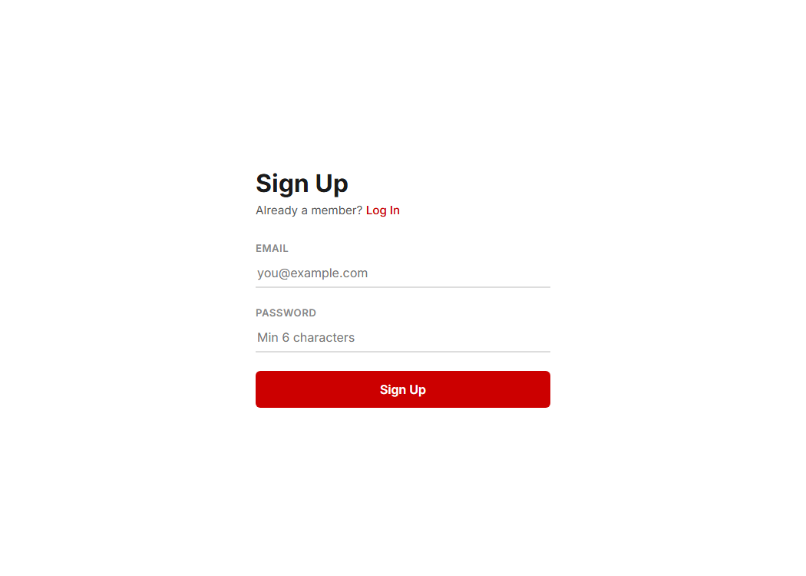
*Initial clean Sign Up interface featuring a centered card on a white background, red accent button, and underline inputs.*

---

### 2. Log In Page
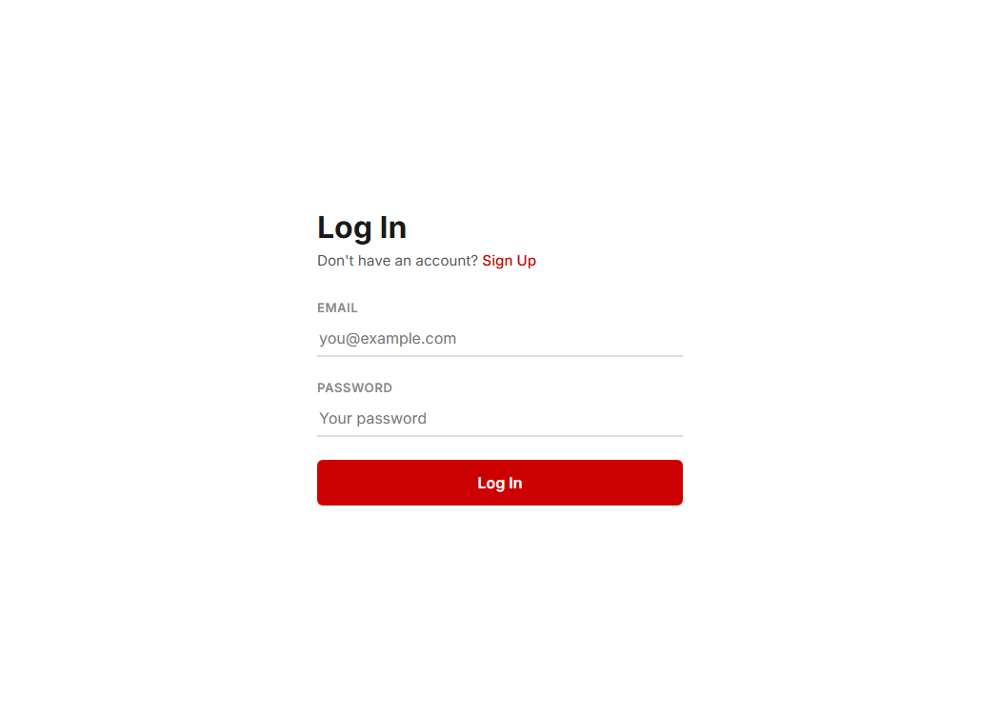
*Log In screen accessible via the "Already a member? Log In" link.*

---

### 3. Registration Success
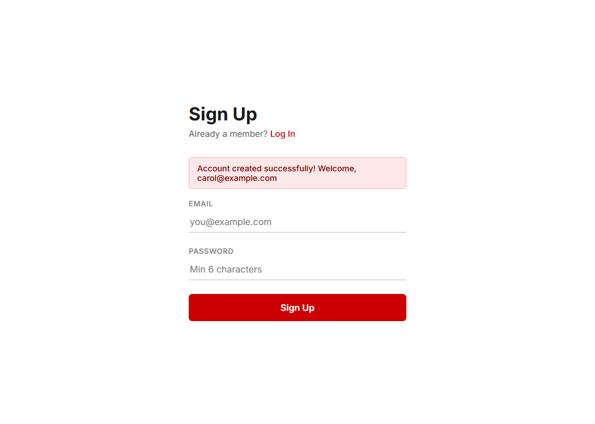
*Successful registration message displayed upon submitting valid user credentials.*

---

### 4. User Management Dashboard
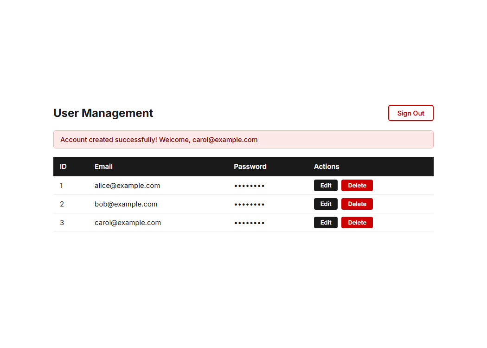
*Dashboard table listing registered users with numeric IDs, email addresses, masked passwords, and Edit/Delete action buttons.*

---

### 5. Edit User Form
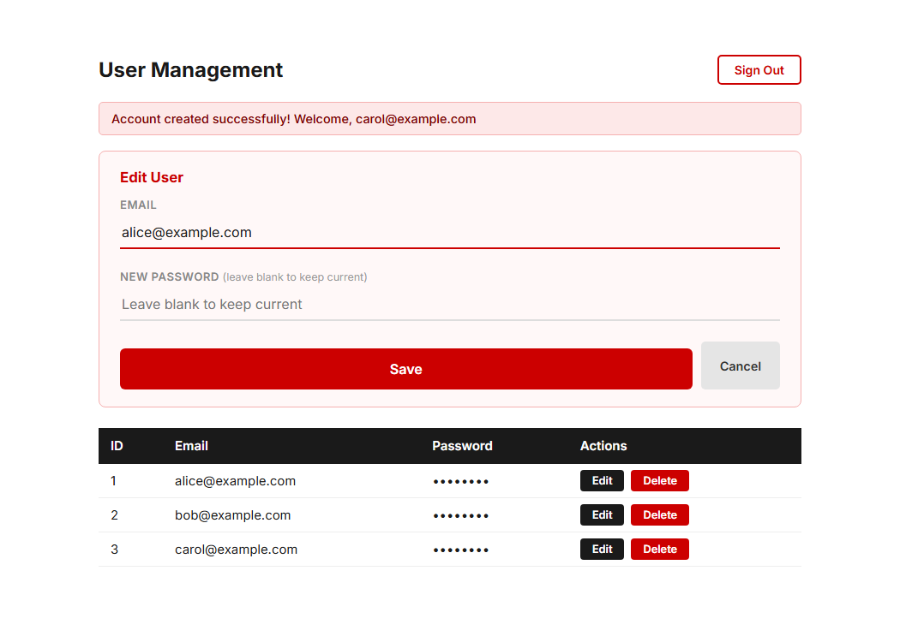
*Edit panel displaying the selected user's email, optional password update field, red Save button, and neutral Cancel button.*

---

### 6. Delete Confirmation Dialog
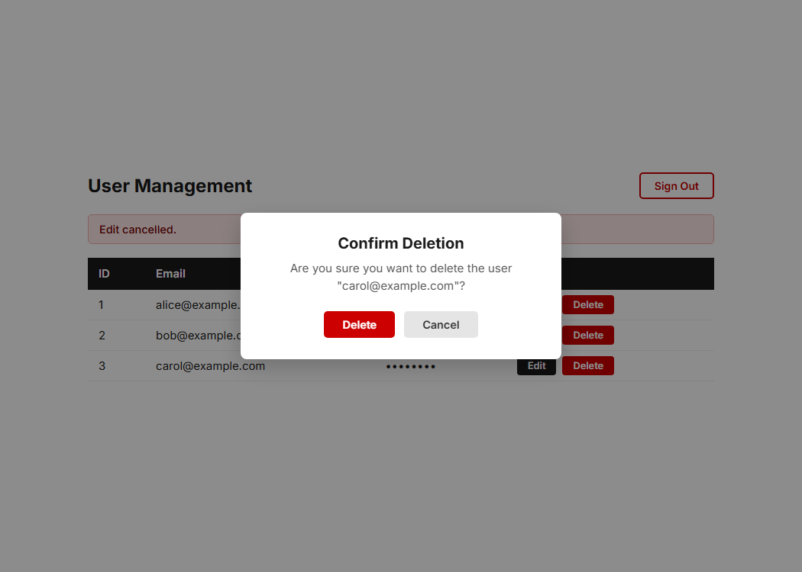
*Confirmation modal dialog preventing accidental user deletion with red Delete and neutral Cancel buttons.*

---

### 7. After Deletion
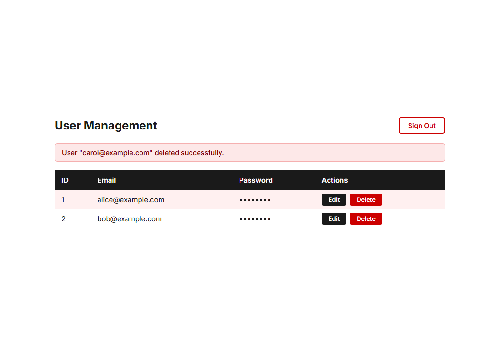
*Dashboard showing success alert banner after deleting a user record and reflecting the updated table state.*

---

## Educational Security Limitations

> [!WARNING]
> This application is built strictly as a **college educational assignment** demonstrating array-based CRUD operations in Express.js. It is **not** a production-ready authentication or identity management system.

1. **In-Memory Storage**: All data is stored in memory and resets whenever the server process restarts.
2. **Password Storage in Demo**: For simplicity in viva demonstrations, dummy passwords are kept in memory without external database hashing dependencies. Real applications must use cryptographic hashing (e.g., bcrypt or argon2) with salts.
3. **No Session Tokens / JWT**: The application relies on client-side state for switching screens. A production system requires stateless JWT or secure HTTP-only cookie sessions.
4. **Data Isolation**: Passwords are never sent back in any GET, POST, or PUT response payload.
5. **No Production Credentials**: Only fictional test credentials (e.g., `alice@example.com`, `bob@example.com`) should ever be entered.

---

## Conclusion

Task 2 expands upon the foundation of Task 1 by introducing user management workflows, multi-screen navigation, client-side validation, and secure API practices (such as masking sensitive fields and isolating task routes). Built cleanly using vanilla HTML, CSS, JavaScript, and Node.js/Express.js without heavy frameworks, it remains easy to explain in a practical examination or viva while demonstrating core software development best practices.

